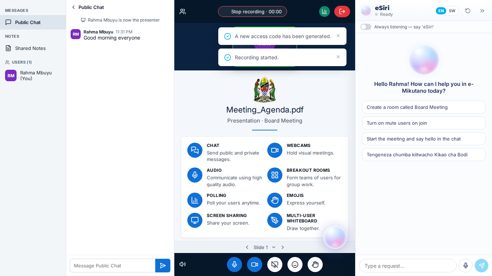
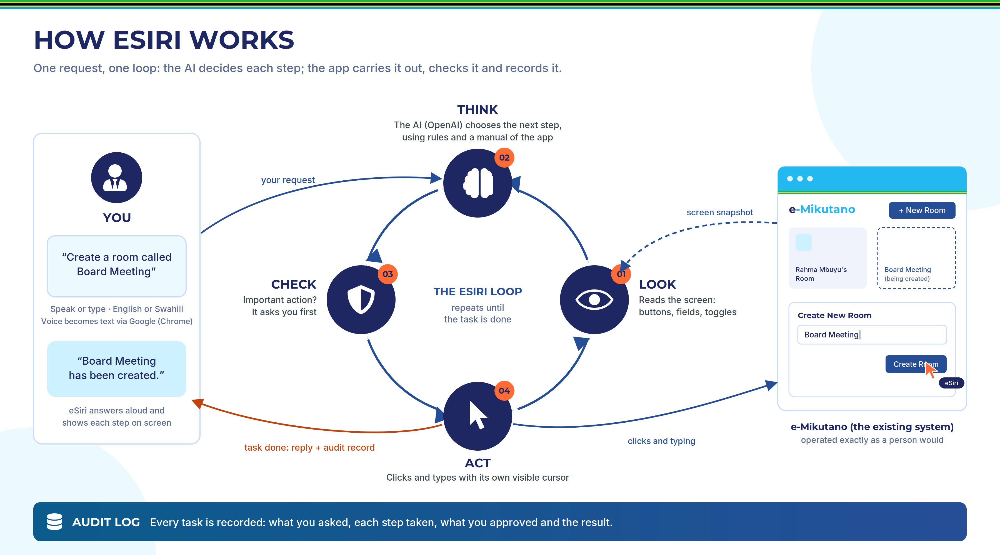
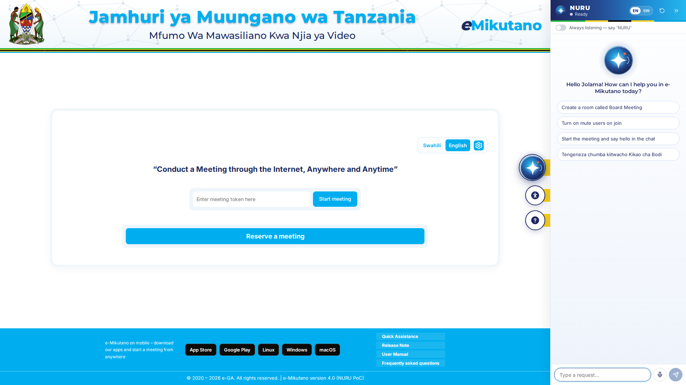
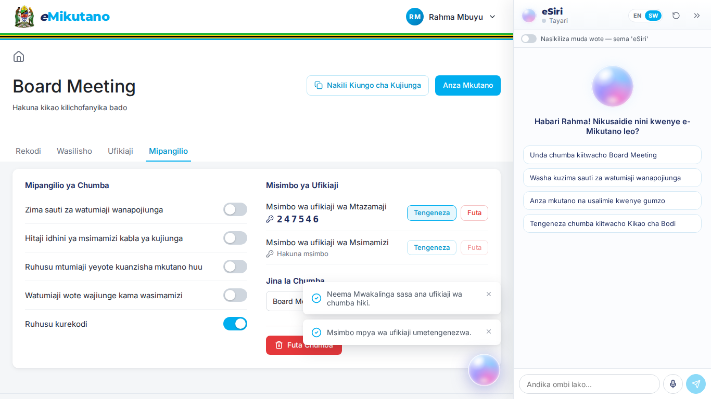
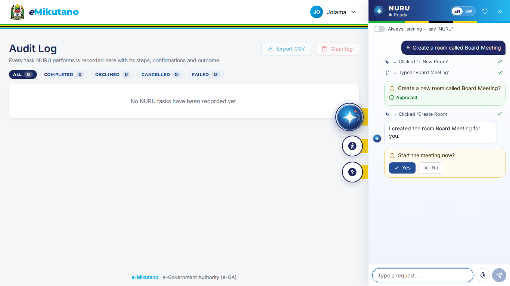
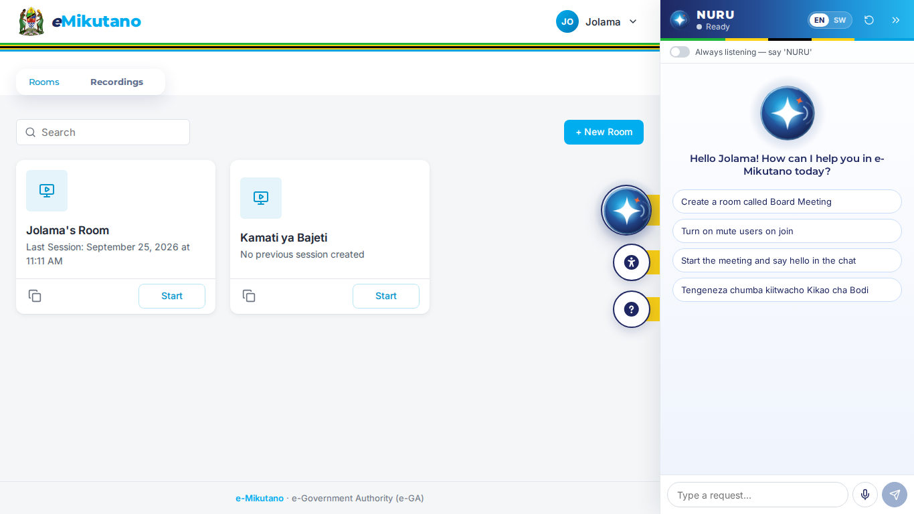
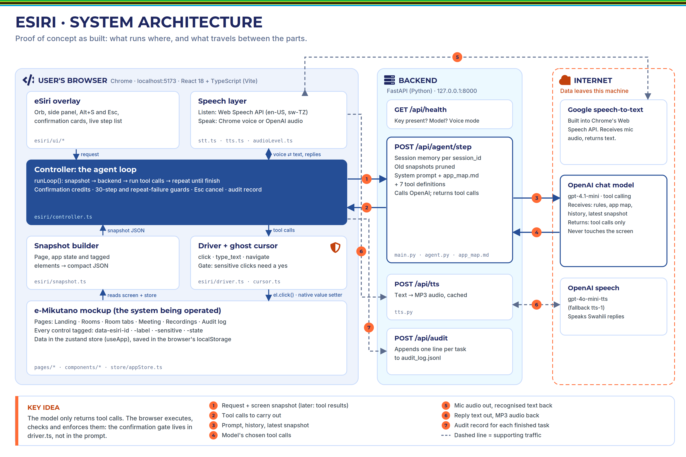
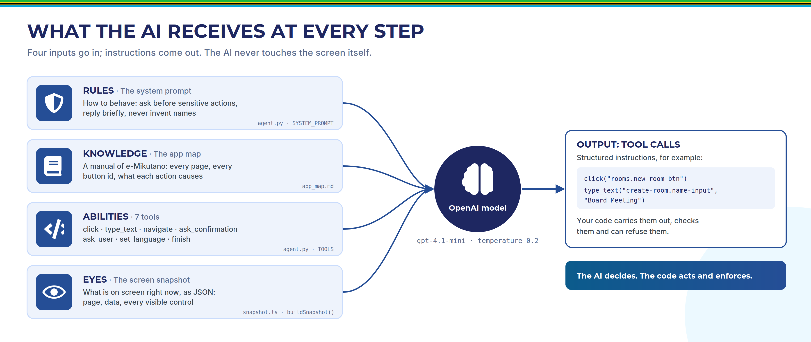
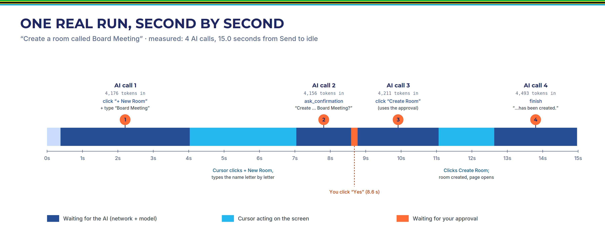

# eSiri — AI Government Agent · e-Mikutano Proof of Concept

**eSiri** is an AI assistant for government web systems, built as a proof of concept for **e-Government Authority (e-GA), Tanzania**. You speak or type a request in **English or Swahili**, and eSiri completes it *inside the existing web system* by visibly moving its own cursor, clicking and typing, exactly as a person would. It asks before consequential actions, enforces that in code, and records every task in an audit log.

The target system in this PoC is a realistic mockup of **e-Mikutano**, Tanzania's government video-conferencing system: rooms, settings, access codes, sharing, presentations, meetings and recordings. There is no real video server. The signed-in user is the fictional **Rahma Mbuyu**.

> **Private repository.** Internal e-GA proof of concept. Do not share outside the team.



---

## How it works



1. **Look.** eSiri reads the screen as a compact JSON snapshot: the page, the app state, and every button, field and toggle with a stable id.
2. **Think.** The OpenAI model (`gpt-4.1-mini` by default) chooses the next steps as tool calls (`click`, `type_text`, `navigate`, `ask_confirmation`, `ask_user`, `set_language`, `finish`).
3. **Check.** Before an important action (create a room, start or join a meeting, record, leave, remove access, delete), eSiri asks. The app **refuses sensitive clicks in code** until you say yes.
4. **Act.** eSiri's ghost cursor clicks and types on screen, then the loop repeats until the task is done. The result is spoken aloud and written to the audit log.

**The AI decides; the code acts and enforces.** The model never touches the screen or the data itself.

### Features

- Voice (Chrome Web Speech API) or typed requests, in English and Swahili; the whole UI, recognition, speech and replies switch language together.
- Visible ghost cursor with highlight and click ripple; every step listed live in a side panel that pushes the page aside.
- Code-enforced confirmation gate, answerable by voice ("yes / ndiyo / sawa", "no / hapana") or buttons.
- Instant cancel: Esc, the Stop button, clicking the orb, or saying "stop / simama / acha".
- Audit log of every task (steps, confirmations, outcome), with filters and CSV export, also written to `backend/audit_log.jsonl`.
- Conversation memory across tasks ("Actually, turn it off again.").
- Swahili speech through OpenAI text-to-speech when Chrome has no Swahili voice.
- Optional wake-word mode ("eSiri, …").
- A fully clickable e-Mikutano mockup that also works without eSiri.

---

## Quick start

```bash
git clone git@github.com:Jolama-code/eSIRI.git
cd eSIRI
cp .env.example .env        # then set OPENAI_API_KEY=sk-... in .env
./start.sh                  # installs everything on the first run, then starts backend + frontend
```

Open **http://localhost:5173** in **Google Chrome**, allow the microphone, click **Reserve a meeting**, then press **Alt+S** and speak.

---

## Documentation

| Document | For |
|---|---|
| [Plain Language Guide (PDF)](Documentation/eSiri_Plain_Language_Guide.pdf) · [Word](Documentation/eSiri_Plain_Language_Guide.docx) | Non-technical explanation of what eSiri is and how it works |
| [Technical Reference (Word)](Documentation/eSiri_Technical_Reference.docx) | Technical explanation for engineers and reviewers |
| [`docs/CODEMAP.md`](docs/CODEMAP.md) | The detailed, code-grounded source of truth: architecture, a full end-to-end trace, the system prompt and tool schemas, a real captured model run, safety, speech, i18n, data flow and privacy, tests, decisions, limitations, extension guide, glossary |
| [`CLAUDE.md`](CLAUDE.md) | Short briefing for AI coding assistants working on this repo |
| Diagrams | [How it works](Documentation/01_conceptual_loop.png) · [Architecture](Documentation/02_architecture.png) · [What the AI receives](Documentation/03_four_inputs.png) · [One real run, second by second](Documentation/04_real_run_timeline.png) |

---

## Requirements

- **Node.js 18+** and npm
- **Python 3.10+**
- **Google Chrome**. Do not use Chromium: its speech recognition fails on Linux with a "network" error.
- An internet connection (Chrome's speech recognition and OpenAI both need it)
- An **OpenAI API key**

## Setup (details)

```bash
cp .env.example .env        # then edit .env and set OPENAI_API_KEY=sk-...
./start.sh                  # installs everything on the first run, then starts backend + frontend
```

Open **http://localhost:5173** in **Google Chrome** and allow the microphone when asked.

`start.sh` creates `backend/.venv`, installs the Python requirements, runs `npm install` in `frontend/` if needed, starts the FastAPI backend on port 8000 and the Vite frontend on port 5173. Press **Ctrl+C** to stop both. The script works from any path, including paths with spaces.

### `.env` settings

| Variable | Default | Meaning |
|---|---|---|
| `OPENAI_API_KEY` | — | Required. |
| `OPENAI_MODEL` | `gpt-4.1-mini` | Chat model used by the agent. |
| `OPENAI_TTS_MODEL` | `gpt-4o-mini-tts` | Text-to-speech model (Swahili voice, optional English voice). Falls back to `tts-1`. |
| `OPENAI_TTS_VOICE` | `coral` | OpenAI voice. |
| `ESIRI_ENGLISH_TTS` | `browser` | `browser` = Chrome voice for English; `openai` = OpenAI voice for English too. |

---

## How to use

- **The orb.** The iridescent orb at the bottom right is on every page. Click it, or press **Alt+S**, and eSiri opens its side panel and starts listening. Speak your request. The larger orb in the middle shows what eSiri is doing: it breathes when idle, follows your voice when listening, swirls faster when thinking, shows a rotating ring when acting, pulses when speaking, and turns briefly red on an error.
- **Stop at any time.** Press **Esc**, click the red Stop button in the panel, click the orb while eSiri is working, or say "stop", "cancel", "simama", "acha" or "sitisha". The task stops at once and is logged as *Cancelled*.
- **The side panel** shows the conversation, the live transcript, every action step (✓/✗), and confirmation cards. It pushes the page aside, so the panel never covers what eSiri clicks. Close it with `»`; a small "eSiri" tab brings it back.
- **Typing works as a fallback.** Type into the panel and press Enter. Suggestion chips show example requests.
- **Confirmations.** Before creating a room, starting or joining a meeting, starting or stopping a recording, leaving a meeting, removing access or deleting something, eSiri asks. Answer by voice ("yes", "go ahead", "ndiyo", "sawa" / "no", "hapana", "acha") or with the Yes/No buttons. The app enforces this in code, not just in the prompt: a sensitive click without an approval is refused.
- **Language.** Switch between English and Swahili with the EN/SW chip in the panel, the Swahili/English toggle on the landing page, or by saying "speak Swahili" / "ongea Kiingereza". The whole UI, speech recognition, eSiri's voice and its replies switch together. Swahili speech uses OpenAI TTS when Chrome has no Swahili voice.
- **Wake mode (optional).** Turn on *"Always listening — say 'eSiri'"* in the panel. eSiri then listens in the background; say "eSiri" or "eSiri, create a room called Finance". A green indicator shows when wake mode is running.
- **Rehearsals.** Use *Reset demo data* in the user menu (top right, "Rahma Mbuyu") to restore the seeded data and clear the audit log.
- **Audit Log.** Open it from the user menu or ask eSiri. Expand rows to see every step and confirmation, filter by outcome, and export CSV. Every task is also appended to `backend/audit_log.jsonl`.

Every screen also works with a normal mouse and keyboard, without eSiri.

---

## 3-minute demo script

Start on the landing page and click **Reserve a meeting** (or ask eSiri to do it). Then click the orb or press Alt+S and say:

1. **"Create a room called Board Meeting."** eSiri opens *+ New Room*, types the name, and asks for confirmation. Say **"Yes."**
2. **"Open the settings, turn on mute users on join, and give me a viewer access code."** eSiri reads the new code aloud digit by digit.
3. **"Share access with Neema Mwakalinga."**
4. **"Add the meeting agenda to the presentation."**
5. **"Start the meeting and tell everyone good morning in the chat."** Say **"Yes"** to confirm. The mic starts muted because of step 2, and the slide shows *Meeting_Agenda.pdf*.
6. **"Start recording."** Say **"Yes."** Wait a few seconds, then say **"Stop recording and leave the meeting."** and **"Yes."** The recording appears in the room's Recordings tab.
7. **"Speak Swahili."** Then say: **"Tengeneza chumba kiitwacho Kikao cha Bodi."** and **"Ndiyo."**
8. **"Fungua kumbukumbu za ukaguzi."** ("Open the audit log.") Show the recorded tasks, expand one, and click *Export CSV*.

Optional extras: "What is the viewer code?", "Actually, turn it off again." (eSiri remembers the context), and pressing **Esc** in the middle of a task.

---

## Troubleshooting

| Problem | Fix |
|---|---|
| **Microphone not working / "Microphone access was blocked"** | Click the padlock in Chrome's address bar → allow the microphone → reload. Check the system input device. You can always type instead. |
| **"Voice recognition needs Google Chrome (not Chromium) and internet"** | This is the `network` error of the Web Speech API. Chromium builds (including snap Chromium on Ubuntu) have no Google speech service. Use Google Chrome with internet access. |
| **No voice output** | Check the system volume and output device. English uses Chrome's voices (the first speech can take a moment while voices load). Swahili uses OpenAI TTS, which needs a valid key. Set `ESIRI_ENGLISH_TTS=openai` to use OpenAI for English too. If speech fails, eSiri still shows the text. Remove `?mute=1` from the URL if present. |
| **"The model … is not available"** | Your key cannot use the configured model. Change `OPENAI_MODEL` in `.env` (for example `gpt-4.1-mini`, `gpt-4.1` or `gpt-4o-mini`) and restart `./start.sh`. |
| **Banner "The OpenAI API key is missing"** | Add `OPENAI_API_KEY=...` to `.env` in the project root and restart. |
| **Ports in use** (`Address already in use` / Vite "Port 5173 is in use") | Stop the other process: `lsof -i :8000` / `lsof -i :5173`, then `kill <pid>`. Or close the other terminal running `start.sh`. |

---

## Screenshots

| Landing page (EN, panel open) | Room settings (Swahili) |
|---|---|
|  |  |
| **Audit log with a conversation in the panel** | **Rooms dashboard** |
|  |  |

All 48 screenshots (every page, English and Swahili, 1366×768 and 1920×1080) are in [`frontend/e2e/screenshots/`](frontend/e2e/screenshots/).

---

## Architecture





```
 Chrome (frontend, Vite + React + TS)                         FastAPI backend (Python)
 ┌──────────────────────────────────────────────┐            ┌────────────────────────────┐
 │ e-Mikutano mockup (every actionable element  │            │ /api/agent/step            │
 │ tagged data-esiri-id / -label / -sensitive)  │  snapshot  │  system prompt + app_map   │
 │                                              │ ─────────▶ │  + session memory          │
 │ eSiri: orb · voice (Web Speech) · panel      │            │  → OpenAI Chat Completions │
 │ controller: loop, confirmation gate, audit   │ ◀───────── │    with tool calling       │
 │ driver ("hands"): ghost cursor click / type  │ tool calls │ /api/tts  (OpenAI TTS)     │
 └──────────────────────────────────────────────┘            │ /api/audit → audit_log.jsonl│
                                                             └────────────────────────────┘
```

1. **Snapshot.** Before every step, the frontend builds a compact JSON snapshot: current page, language, open modal, toasts, a summary of the app state (rooms, current room settings, access codes, shared users, meeting state), and every visible element with a `data-esiri-id` (role, label in the current language, state, disabled, sensitive).
2. **LLM.** The backend sends the system prompt (rules plus the app map in `backend/app/app_map.md`), the conversation memory (last ~12 user turns, with older snapshots pruned), and the newest snapshot to OpenAI with seven tools: `click`, `type_text`, `navigate`, `ask_confirmation`, `ask_user`, `set_language`, `finish`.
3. **Visible actions.** The frontend executes the returned tool calls in order with a ghost cursor that glides to each element, highlights it, shows a click ripple and clicks, or types character by character. After each batch it sends the results and a fresh snapshot back, and the loop continues until `finish`.
4. **Confirmation gate.** Sensitive elements carry `data-esiri-sensitive="true"`. The driver refuses to click them unless the user approved an `ask_confirmation` in the current task that still has unused credits (`covers`). This is enforced in code, so the model cannot skip it.
5. **Audit trail.** Every task produces one record (request, input mode, language, each step, each confirmation, outcome: Completed / Declined / Cancelled / Failed, final message, duration). It is stored in the browser and appended to `backend/audit_log.jsonl`.

Guards: at most 30 tool executions per task; stop after the same action fails 3 times; any network or model error ends the task with a spoken, localized message; every speech call resolves on a timeout, so audio can never block the loop.

**Towards production** (not built in this PoC): the same agent loop could drive real legacy government systems. The "hands" would become Playwright browser automation (the same snapshot → tool-call → action pattern, run server-side against the real web UI) or direct REST API calls where they exist, with the same confirmation gate and audit trail. A real system will not have the `data-esiri-*` tags this mockup was built with; see the extension guide in `docs/CODEMAP.md`.

---

### Performance (measured)



"Create a room called Board Meeting" took **15 seconds** from Send to done: 4 AI calls of about 4,200–4,500 prompt tokens each, the cursor animations, and the user's confirmation.

---

## Project layout

```
frontend/             Vite + React 18 + TypeScript app (mockup + eSiri)
  src/pages/          Landing, Rooms, Recordings, Room page, Meeting, Audit
  src/esiri/          controller (agent loop), driver + cursor (actions), snapshot, speech (stt/tts), panel, orb
  src/store/          zustand stores (persisted in localStorage)
  src/i18n/           en.ts / sw.ts (identical keys, enforced by TypeScript)
  e2e/                Playwright tests and screenshots
backend/              FastAPI app
  app/main.py         endpoints, session memory, OpenAI calls
  app/agent.py        system prompt, tool definitions, memory helpers
  app/app_map.md      the agent's knowledge of the e-Mikutano mockup (injected into the prompt)
  app/tts.py          OpenAI text-to-speech with cache
Documentation/        Plain Language Guide, Technical Reference, diagrams
docs/CODEMAP.md       detailed technical source of truth
start.sh              one command to install and run everything
```

Not in the repository (kept on the owner's machine, git-ignored): `.env` (the API key), `reference/` (original e-Mikutano screenshots used as design references) and `ESIRI_BUILD_PROMPT.md` (the original build specification). The app does not need them to run.

---

## Tests

```bash
cd frontend
npm run build                 # type-check + production build (zero TypeScript errors)
npx playwright install chromium
npx playwright test           # all 27 tests (starts backend + frontend automatically if not running)
npm run test:e2e:nollm        # 18 tests that do not need the OpenAI key
npm run test:e2e:llm          # 9 eSiri agent tests (need the key)
```

| Suite | Tests | What it proves |
|---|---|---|
| `e2e/ui.spec.ts` | 14 | The mockup works for humans (create room, settings, access, presentation, meeting features, recordings, audit, CSV export, language toggle, token join); the code-enforced confirmation gate; the snapshot; the TTS and audit endpoints |
| `e2e/agent.spec.ts` `@llm` | 8 | The required eSiri scenarios, driven only through the panel's text input, asserting final app state (create, settings, share, meeting + chat, record/stop/leave, Swahili, decline, Esc cancel) |
| `e2e/demo.spec.ts` `@llm` | 1 | The full demo script as one continuous conversation |
| `e2e/screenshots.spec.ts` | 4 | Every page in English and Swahili at 1366×768 and 1920×1080, with overflow checks |

Latest full run: **27 of 27 passed**. `demo.spec.ts` is occasionally flaky (about 1 in 6 runs, passes on the automatic retry): in a long conversation the model can mistake the Swahili room name "Kikao cha Bodi" for the existing "Board Meeting" and ask a question instead of acting. Automated tests run with `?mute=1` (no speech, no microphone), so real voice input and output need a manual check in Chrome.

---

## Known limitations

- The mockup was built with `data-esiri-*` tags for the agent; a real third-party system will not have them.
- The confirmation gate runs in the browser (strong against the AI, not a server-side security control), and an approval is not tied to one specific button.
- Single fictional user, no authentication; all app data lives in the browser's localStorage.
- Needs internet: OpenAI (reasoning and Swahili speech) and Google (Chrome speech recognition). Voice input needs Google Chrome.
- Each step's screen snapshot is sent to OpenAI, including room names, join tokens, access codes and recent chat messages.
- About 15 seconds for a four-step task.

Full, honest list with details: [`docs/CODEMAP.md` §19](docs/CODEMAP.md#19-known-limitations-and-weaknesses).
